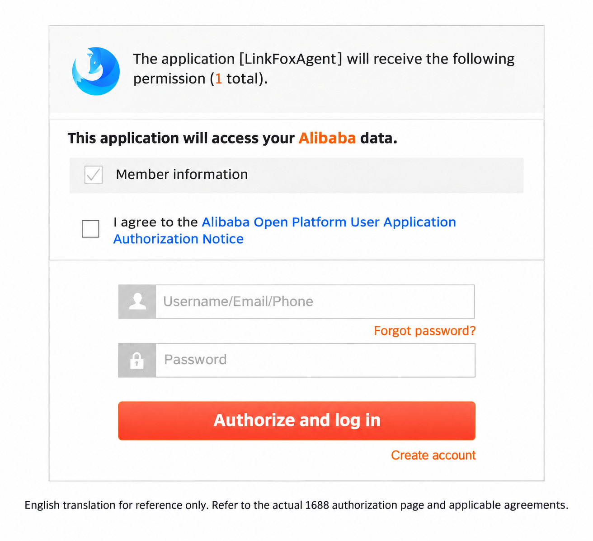

# 1688 authorization and procurement

The 14 procurement APIs use your Nexscope API key and your own authorized 1688 buyer account. They complement the four public 1688 sourcing APIs; product discovery alone does not authorize purchases.

## Authorize your buyer account

1. Call [Authorize URL](data/1688-authorize-url.md) with a recognizable `accountName`.
2. Open the returned URL yourself and complete authorization within 10 minutes. Authorization is supported by **LinkFox Agent, Nexscope's strategic partner in China**; that is the application name shown by 1688. No separate LinkFox account or API key is required.
3. The permission descriptions and agreement notice are in Chinese. Use your browser's translation feature and select English. Changing the browser language alone does not switch these sections to English.
4. Call [Authorized Stores](data/1688-authorized-stores.md) and verify the intended account is `ACTIVE` with `expired=false`. A success redirect or the reference screenshot alone does not prove authorization. If the link expires or authorization fails, request a fresh URL and repeat the check.

This image is a reference translation only. Consult the actual 1688 authorization page and applicable agreements. Use data only within the scope of your authorization and in accordance with applicable local laws, regulations, and platform terms. Never display or paste OAuth access/refresh tokens into API examples or chat.

## Replace placeholder IDs

Example product, SKU, address, order and logistics IDs are illustrative, not verified records available to your account. Keep identifiers as strings to preserve precision.

| Needed value | How to obtain it |
|---|---|
| `offerId` | Select a real 1688 product using the public sourcing APIs or the product page. |
| `specId` | Inspect [SKU](data/1688-sku.md) for that product. |
| `addressId` | Select your buyer's address from [Receive Address List](data/1688-receive-address-list.md). |
| `aliOrderId`, `orderIdList`, `orderIds` | Use actual order IDs returned for your buyer; preserve each operation's field name. |
| `logisticsId` | Use a logistics identifier returned for that order when needed. |

Prefer `addressId`; otherwise provide the documented `addressParam` fields. Direct preview/create API calls must explicitly provide `flow`, normally `general`, and a nonempty `cargoParamList`. Preview-only `invoiceParam` is not a creation field. Consult each operation's complete request definition for nested types, enum values and conditional requirements.

## Confirm each sensitive action

First preview the selected products, quantities, prices, shipping address and other order terms. Obtain the user's explicit approval for the exact action before setting its confirmation field to JSON boolean `true`. Strings such as `"true"` or numeric `1` are not substitutes. Published samples keep these fields `false` deliberately.

| Operation | Confirmation field |
|---|---|
| [Create Order](data/1688-create-order.md) | `confirmCreateOrder` |
| [Payment URL](data/1688-payment-url.md) | `confirmGetPaymentUrl` |
| [Confirm Receive](data/1688-confirm-receive.md) | `confirmReceive` |
| [Cancel Order](data/1688-cancel-order.md) | `confirmCancel` |
| [Invoice Apply](data/1688-invoice-apply.md) | `confirmApplyInvoice` |

Creating a payment URL is not proof that an order was paid. Creating an order is not proof it was shipped. Check the appropriate order and logistics results before proceeding. Do not automatically retry writes after a timeout, transport error or ambiguous response; reconcile the order state first. Do not switch the buyer account silently.

## Billing and response checks

Invoking these APIs consumes credits, including authorization and authorized-account checks. The portable procurement Skill performs a separate billable `authorizedStores` precheck before each non-authorization operation. The generic API clients in this repository send only the single request you choose; they do not add that precheck or automatically poll. Backend token exchange/refresh does not create an additional public API call.

Inspect the Nexscope outer `code` and then the nested business result. `code=0` and HTTP 200 do not guarantee every order/invoice item succeeded. Check nested `status`, `success`, failed items and returned identifiers. Outer `cost` is elapsed time in milliseconds, not credit usage.

| Nexscope outer code | Meaning and next step |
|---|---|
| `11209` | Missing or invalid Nexscope API key; correct authentication. |
| `99001` | Invalid parameters, missing confirmation, or pricing configuration error; inspect the message. |
| `13007` | Buyer authorization unavailable or procurement call failed; inspect the message before deciding whether reauthorization is needed. |
| `13011` | Insufficient Nexscope credits. |
| `99000` | Unexpected service failure; retain trace information and reconcile uncertain writes. |

Provider error codes inside `data` are a separate layer and must not be treated as Nexscope outer error codes. Gateway HTTP 401/402 may also indicate authentication or credit errors. Preserve the trace identifier when reporting a problem. Do not expose buyer personal/address details unnecessarily.

[All procurement APIs](../README.md#1688-procurement-14) · [Official authorization guide](https://www.nexscope.ai/api-docs/1688-authorize-url?view=api&co-from=github-ecommerce-api)
